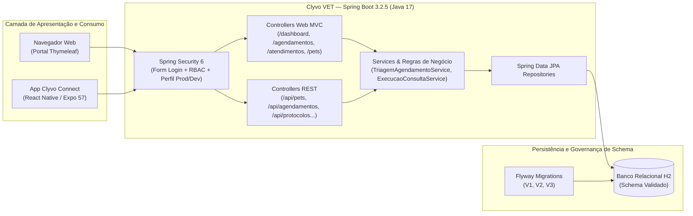
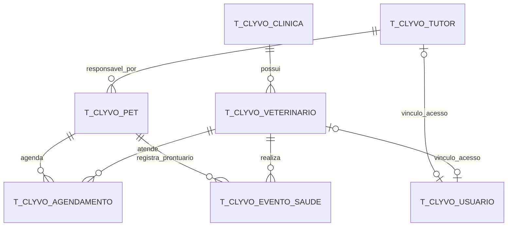

# Clyvo VET — Plataforma Web e API Clínica Veterinária

Plataforma web (Spring MVC + Thymeleaf) e API RESTful voltada à gestão contínua de saúde preventiva, triagem inteligente de agendamentos e prontuário unificado para clínicas veterinárias e tutores.

## Aplicação no ar

| Recurso | Endereço |
| :--- | :--- |
| **Portal Web** | https://clyvo-vet.onrender.com |
| **Swagger UI** | https://clyvo-vet.onrender.com/swagger-ui.html |
| **OpenAPI JSON** | https://clyvo-vet.onrender.com/api-docs |

> O serviço roda no plano gratuito do Render, que hiberna após período de inatividade. A primeira requisição pode levar cerca de 50 segundos até o contêiner subir; as seguintes respondem normalmente.

## Integrantes (Turma 2TDSPV)

| Nome | RM |
| :--- | :--- |
| Gabriel Costa Solano | 562325 |
| Kaiky Pereira Rodrigues Da Silva | 564578 |
| Leandro Guarido de Oliveira | 561760 |

---

## 1. Narrativa da Solução e Proposta de Valor

### O Problema Real
Clínicas veterinárias de pequeno e médio porte e tutores de animais domésticos enfrentam três gargalos recorrentes na rotina de saúde animal:
1. **Fragmentação de prontuários e perda de histórico preventivo:** carteiras de vacinação em papel e registros isolados dificultam o acompanhamento da evolução ponderal (peso), alergias e protocolos de reforço vacinal ou vermifugação por espécie.
2. **Conflitos de agenda (double-booking) e ausência de triagem prévia:** marcações manuais sem validação de disponibilidade geram sobreposição de horários para o mesmo médico veterinário ou para o mesmo animal, além de não prepararem a equipe clínica quanto à urgência ou necessidade de jejum prévio.
3. **Desconexão entre a operação clínica (Web) e o tutor em mobilidade (Mobile):** a clínica precisa de uma estação de trabalho estruturada para fila de atendimento e registro de anamnese, enquanto o tutor necessita consultar protocolos, prontuários e solicitar agendamentos pelo celular consumindo a mesma base de dados em tempo real.

### A Solução: Ecossistema Clyvo VET
O **Clyvo VET** resolve esse cenário unificando dois módulos complementares sobre o mesmo domínio transacional:
- **Portal Web Clínico e do Tutor (Spring MVC + Thymeleaf + Spring Security 6):** interface web responsiva com controle de acesso baseado em papéis (`ROLE_VET`, `ROLE_TUTOR`, `ROLE_ADMIN`), painel de indicadores em tempo real, motor de triagem e agendamento com prevenção ativa de conflitos, fila clínica exclusiva para médicos veterinários e atualização atômica de prontuário.
- **API RESTful Integrada (`/api/**` + OpenAPI 3 / Swagger):** camada de serviços padronizada com paginação, filtros dinâmicos, cache em memória e tratamento global de exceções, consumida diretamente pelo aplicativo móvel **Clyvo Connect** (React Native / Expo).

---

## 2. Arquitetura, Decisões de Design e Justificativas Tecnológicas

### Stack Tecnológica
- **Java 17 (LTS) & Spring Boot 3.2.5**
- **Spring Web (MVC & REST)**
- **Spring Data JPA / Hibernate** (`ddl-auto=validate`)
- **Spring Security 6** (autenticação Form Login, criptografia `BCryptPasswordEncoder`, autorização RBAC em rotas e fragmentos de view com `thymeleaf-extras-springsecurity6`)
- **Thymeleaf** (renderização server-side com fragmentos reutilizáveis em `templates/fragments/layout.html`)
- **Flyway Migration** (versionamento determinístico de schema e carga inicial em `src/main/resources/db/migration`)
- **Banco de Dados H2** (modo em memória com console isolado no perfil de desenvolvimento)
- **Jakarta Bean Validation** (validação declarativa nos DTOs de entrada web e REST)
- **Springdoc OpenAPI 2.5.0** (documentação interativa Swagger UI em `/swagger-ui.html`)
- **Spring Cache** (`@EnableCaching` para otimização de leituras frequentes)
- **JUnit 5, Mockito & Spring Security Test (`MockMvc`)** (37 testes automatizados cobrindo regras temporais, fluxos clínicos, invalidação de cache e controle de acesso)
- **Docker & Render** (`Dockerfile` multi-stage com Eclipse Temurin 17 JRE Jammy e manifesto `render.yaml`)

### Diagrama de Arquitetura e Fluxo de Dados



### Decisões de Design Relevantes
1. **Fluxos de Negócio Não-CRUD Dedicados:**
   - [`TriagemAgendamentoService`](src/main/java/br/com/fiap/clyvovet/service/TriagemAgendamentoService.java): valida janela de funcionamento clínico (segunda a sábado, das 08h às 18h), antecedência mínima de 1 hora, bloqueio de choque de horário do veterinário (janela de 30 minutos) e bloqueio de agendamento simultâneo para o mesmo pet, além de enriquecer a observação com a classificação de triagem e recomendação de jejum.
   - [`ExecucaoConsultaService`](src/main/java/br/com/fiap/clyvovet/service/ExecucaoConsultaService.java): executa em transação única (`@Transactional`) a validação de status do agendamento, o cálculo de variação ponderal com alerta automático caso a oscilação supere 20%, a atualização biométrica do pet, o encerramento do agendamento (`CONCLUIDO`) e a geração dos registros clínicos e preventivos no prontuário (`EventoSaude`).
2. **Determinismo Temporal para Testabilidade (`java.time.Clock`):**
   - A injeção de um bean `Clock` ([`ClockConfig`](src/main/java/br/com/fiap/clyvovet/config/ClockConfig.java)) permite que os serviços de agendamento e consulta sejam validados em qualquer dia ou horário pela suíte de testes automatizados sem falsos negativos.
3. **Isolamento de Segurança por Ambiente (`default` vs. `prod`):**
   - [`H2ConsoleSecurityConfig`](src/main/java/br/com/fiap/clyvovet/config/H2ConsoleSecurityConfig.java) utiliza `@ConditionalOnProperty(name = "spring.h2.console.enabled", havingValue = "true")`, garantindo que em produção (`SPRING_PROFILES_ACTIVE=prod`) o console H2 e seu link no rodapé fiquem completamente desativados, enquanto em desenvolvimento local permanecem acessíveis.

---

## 3. Modelo Entidade-Relacionamento (Banco de Dados e Flyway)

O schema relacional é gerenciado exclusivamente pelo **Flyway** e validado pelo Hibernate (`spring.jpa.hibernate.ddl-auto=validate`):
- [`V1__create_domain_tables.sql`](src/main/resources/db/migration/V1__create_domain_tables.sql): criação das 7 tabelas de domínio (`t_clyvo_clinica`, `t_clyvo_veterinario`, `t_clyvo_tutor`, `t_clyvo_pet`, `t_clyvo_agendamento`, `t_clyvo_evento_saude`, `t_clyvo_protocolo`) com chaves primárias, estrangeiras e constraints de unicidade (`nr_cnpj`, `nr_crmv`, `nr_cpf`).
- [`V2__create_security_tables.sql`](src/main/resources/db/migration/V2__create_security_tables.sql): criação da tabela `t_clyvo_usuario` e índice `idx_clyvo_usuario_email` para autenticação e RBAC.
- [`V3__insert_seed_data.sql`](src/main/resources/db/migration/V3__insert_seed_data.sql) + [`DataLoader`](src/main/java/br/com/fiap/clyvovet/seed/DataLoader.java): carga inicial de clínicas, veterinários, tutores, pets, agendamentos, eventos de saúde, protocolos preventivos e usuários com senhas criptografadas em BCrypt.



---

## 4. Integração Multidisciplinar

A solução **Clyvo VET** consolida na prática os conhecimentos das demais disciplinas do semestre:

| Disciplina | Aplicação Prática na Solução | Evidências no Projeto |
| :--- | :--- | :--- |
| **Java Advanced** | Arquitetura em camadas com Spring Boot 3.2, Spring MVC + Thymeleaf, Spring Security 6 (RBAC), Bean Validation, OpenAPI 3 e testes automatizados com JUnit 5 / MockMvc. | Pacotes em [`src/main/java/br/com/fiap/clyvovet`](src/main/java/br/com/fiap/clyvovet), templates em [`src/main/resources/templates`](src/main/resources/templates) e testes em [`src/test/java`](src/test/java). |
| **Mobile Application Development** | Consumo direto da API REST (`/api/pets`, `/api/agendamentos`, `/api/clinicas`, `/api/veterinarios`, `/api/protocolos`, `/api/eventos-saude`) pelo aplicativo **Clyvo Connect** (React Native / Expo 57 + TanStack Query), disparando notificações locais no celular a partir das regras de agendamento e conflito deste backend. | Repositório Mobile (`2tdspv-challenge-clyvo-connect`), configuração CORS em [`CorsConfig.java`](src/main/java/br/com/fiap/clyvovet/config/CorsConfig.java) e liberação `/api/**` em [`SecurityConfig.java`](src/main/java/br/com/fiap/clyvovet/config/SecurityConfig.java). |
| **Mastering Relational and Non-Relational Database** | Modelagem relacional em 3ª Forma Normal (3FN), integridade referencial por chaves estrangeiras, índices de busca e versionamento evolutivo de schema via Flyway. | Scripts SQL [`V1__create_domain_tables.sql`](src/main/resources/db/migration/V1__create_domain_tables.sql), [`V2__create_security_tables.sql`](src/main/resources/db/migration/V2__create_security_tables.sql) e [`V3__insert_seed_data.sql`](src/main/resources/db/migration/V3__insert_seed_data.sql). |
| **DevOps Tools & Cloud Computing / Compliance & QA** | Containerização Docker multi-stage, infraestrutura como código (`render.yaml`), segregação de perfis (`dev`/`prod`), coleção Postman automatizável e suíte de 37 testes de unidade e integração. | [`Dockerfile`](Dockerfile), [`render.yaml`](render.yaml), [`application-prod.properties`](src/main/resources/application-prod.properties), [`ClyvoVET-API.postman_collection.json`](documentos/ClyvoVET-API.postman_collection.json) e [`cronograma.md`](documentos/cronograma.md). |

---

## 5. Credenciais de Acesso (Homologação e Demonstração)

A tela de login (`/login`) conta com preenchimento rápido para os três perfis configurados:

| Perfil | E-mail | Senha | Papel (`Role`) | Permissões Principais |
| :--- | :--- | :--- | :--- | :--- |
| **Médica Veterinária** | `veterinario@clyvo.com` | `admin123` | `ROLE_VET` | Painel clínico completo, **Fila Clínica** (`/atendimentos`), início e conclusão de consultas com atualização de prontuário, triagem e visualização de todos os pets. |
| **Tutor** | `tutor@clyvo.com` | `tutor123` | `ROLE_TUTOR` | Painel restrito aos próprios animais (`Thor` e `Luna`), visualização de prontuário e protocolos preventivos, solicitação e cancelamento dos próprios agendamentos (bloqueado com **HTTP 403** em `/atendimentos`). |
| **Administrador** | `admin@clyvo.com` | `admin123` | `ROLE_ADMIN` | Perfil de supervisão: visão gerencial de indicadores, acesso à **Fila Clínica** (`/atendimentos`) e à triagem, além da visualização de todos os pets e prontuários da plataforma. |

---

## 6. Principais Rotas Web e Endpoints da API REST

### Rotas do Portal Web (Thymeleaf)
- `GET /login` — Autenticação no portal com atalhos de demonstração por perfil.
- `GET /dashboard` — Painel adaptativo conforme o perfil autenticado (`ROLE_VET` ou `ROLE_TUTOR`).
- `GET /agendamentos` — Central de agendamentos clínicos e cancelamento.
- `GET /agendamentos/novo` & `POST /agendamentos/solicitar` — Fluxo de triagem clínica e reserva de horário com validação de conflitos.
- `GET /atendimentos` — Fila clínica exclusiva para médicos veterinários (`hasRole('VET')`).
- `GET /atendimentos/{id}/iniciar` & `POST /atendimentos/finalizar` — Execução de consulta clínica e atualização atômica do prontuário.
- `GET /pets` & `GET /pets/{id}/prontuario` — Fichas biométricas, histórico de eventos de saúde e protocolos preventivos recomendados.

### Endpoints da API REST (`/api/**`)
| Recurso | Base Path | Operações Suportadas |
| :--- | :--- | :--- |
| **Pets** | `/api/pets` | `GET` (paginado / filtro por espécie e nome), `GET /{id}`, `POST`, `PUT /{id}`, `DELETE /{id}` |
| **Agendamentos** | `/api/agendamentos` | `GET` (paginado / filtro por status e tipo), `GET /{id}`, `POST`, `PUT /{id}`, `DELETE /{id}` |
| **Eventos de Saúde** | `/api/eventos-saude` | `GET` (paginado / filtro por tipo), `GET /{id}`, `POST`, `PUT /{id}`, `DELETE /{id}` |
| **Protocolos Preventivos** | `/api/protocolos` | `GET` (paginado / filtro por espécie e tipo), `GET /{id}`, `POST`, `PUT /{id}`, `DELETE /{id}` |
| **Clínicas** | `/api/clinicas` | `GET` (com cache), `GET /{id}`, `POST`, `PUT /{id}`, `DELETE /{id}` |
| **Veterinários** | `/api/veterinarios` | `GET` (filtro por especialidade), `GET /{id}`, `POST`, `PUT /{id}`, `DELETE /{id}` |
| **Tutores** | `/api/tutores` | `GET` (paginado / busca por nome), `GET /{id}`, `POST`, `PUT /{id}`, `DELETE /{id}` |

A coleção completa para testes no Postman encontra-se em [`documentos/ClyvoVET-API.postman_collection.json`](documentos/ClyvoVET-API.postman_collection.json).

---

## 7. Como Executar Localmente e via Docker

### Pré-requisitos
- **JDK 17** configurado no `JAVA_HOME` (o Maven Wrapper já está incluído no projeto).

### Passo a Passo (Execução Local)
```bash
# Windows (PowerShell / CMD)
.\mvnw.cmd spring-boot:run

# Linux / macOS
./mvnw spring-boot:run
```

### Executando a Suíte de Testes Automatizados (37 testes)
```bash
# Windows
.\mvnw.cmd test

# Linux / macOS
./mvnw test
```

### Execução com Docker (Perfil de Produção)
```bash
docker build -t clyvo-vet .
docker run -p 8080:8080 -e SPRING_PROFILES_ACTIVE=prod clyvo-vet
```

### Endereços Locais e em Nuvem

| Recurso | Endereço Local | Em Nuvem (Render) |
| :--- | :--- | :--- |
| **Portal Web** | `http://localhost:8080` | https://clyvo-vet.onrender.com |
| **Swagger UI** | `http://localhost:8080/swagger-ui.html` | https://clyvo-vet.onrender.com/swagger-ui.html |
| **OpenAPI JSON** | `http://localhost:8080/api-docs` | https://clyvo-vet.onrender.com/api-docs |
| **Console H2** | `http://localhost:8080/h2-console` | Desabilitado em produção (exclusivo do perfil `dev`) |

---

## 8. Deploy em Nuvem (Render) e Artefatos de Entrega

A aplicação está publicada e acessível em **https://clyvo-vet.onrender.com**, a partir do manifesto [`render.yaml`](render.yaml) e do [`Dockerfile`](Dockerfile) multi-stage (ambiente Docker, perfil `SPRING_PROFILES_ACTIVE=prod`, porta dinâmica `${PORT:8080}`, branch `develop`).

- **Aplicação em nuvem:** https://clyvo-vet.onrender.com
- **Repositório GitHub (Java Advanced):** https://github.com/LeandroGuaridoOliveira/Sprint-4-java
- **Coleção Postman:** [`documentos/ClyvoVET-API.postman_collection.json`](documentos/ClyvoVET-API.postman_collection.json)
- **Cronograma de Sprints:** [`documentos/cronograma.md`](documentos/cronograma.md)
